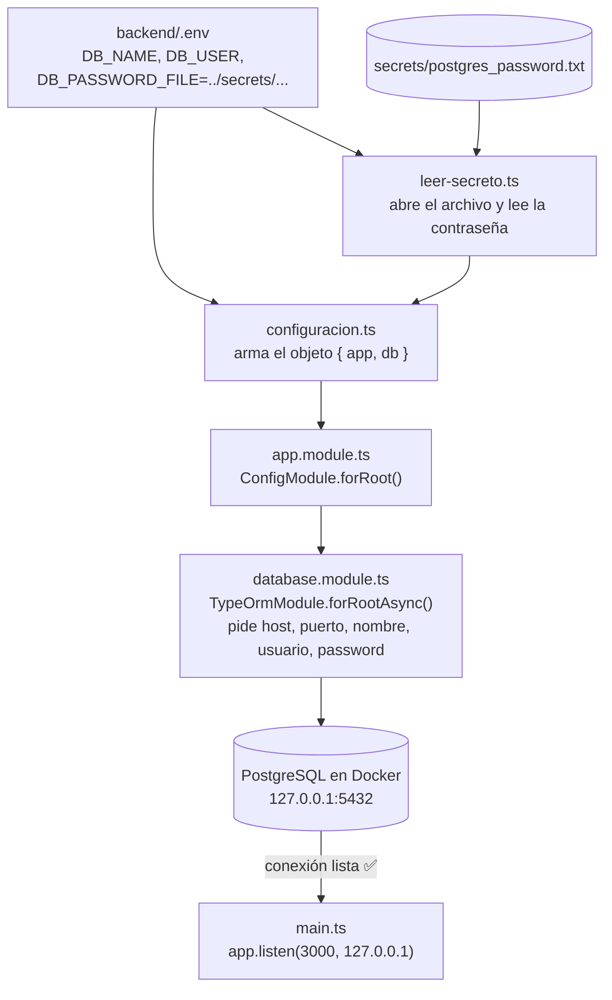
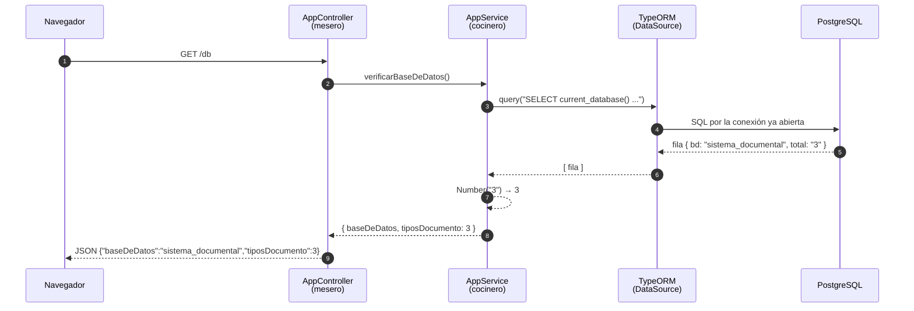
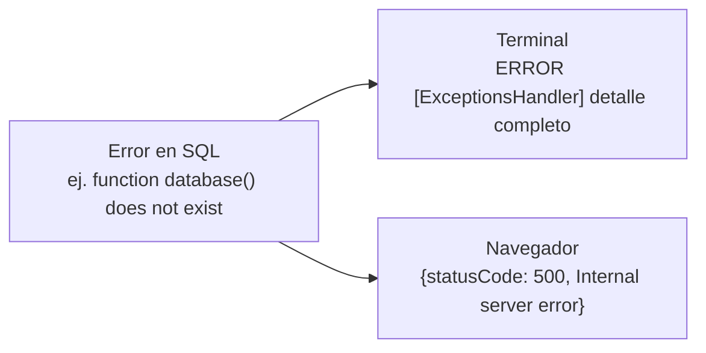

# 07 — Cómo viaja el dato (Lección 3)

Hay **dos momentos** distintos: el **arranque** (pasa una sola vez) y cada **petición** (pasa cada vez que abres `/db`).

## 1. Arranque: la app prepara la conexión (una sola vez)

- Si falta un secreto, el flujo se corta en **leer-secreto.ts** y la app no arranca.
- La contraseña viaja de `secrets/` a la conexión **sin aparecer nunca en el código**.

## 2. Petición: abrir `http://127.0.0.1:3000/db`

## 3. Si algo falla en la petición

El **detalle** se queda en el servidor (para ti); el usuario solo ve un mensaje genérico (seguridad).

## Quién hace qué
| Pieza | Responsabilidad | Analogía |
|---|---|---|
| Controlador | Recibe la ruta y responde | Mesero |
| Servicio | Hace el trabajo (consulta) | Cocinero |
| TypeORM / DataSource | Traduce y envía el SQL | Intérprete |
| PostgreSQL | Guarda y devuelve los datos | Bodega |
